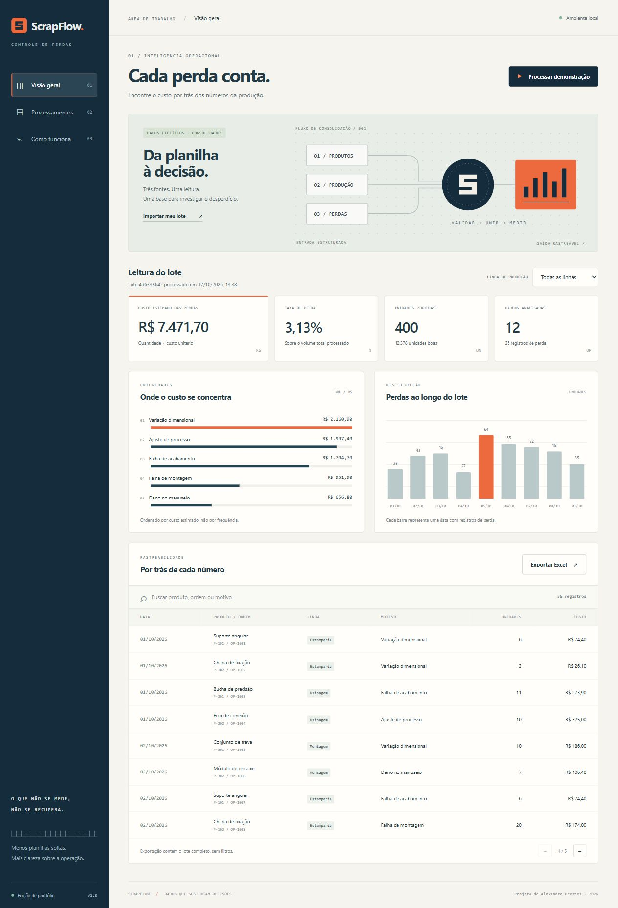
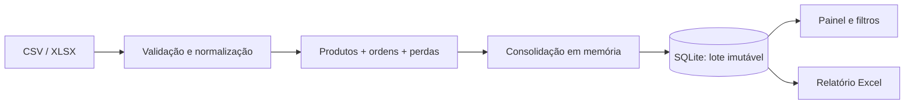

# ScrapFlow

**Controle de perdas de produção, da entrada dos arquivos ao relatório Excel.**

ScrapFlow é uma aplicação local em Python que consolida cadastro de produtos, ordens de produção e registros de perda. Valida as relações entre os arquivos, calcula indicadores e permite investigar os resultados em um painel.

Desenvolvi esta edição para demonstrar um fluxo completo de automação e análise de dados, com regras explícitas e exemplos reproduzíveis. Os dados são fictícios; o projeto não representa uma empresa ou operação real.



## Experimente em poucos minutos

Requisitos: **Python 3.11 ou superior**. Não é necessário instalar Microsoft Excel, Node.js ou um servidor de banco de dados para usar a aplicação.

```bash
git clone https://github.com/alex10presam-lang/scrapflow.git
cd scrapflow
python -m venv .venv
```

No Windows:

```powershell
.\.venv\Scripts\python.exe -m pip install -r requirements.txt
.\.venv\Scripts\python.exe app.py
```

No Linux ou macOS:

```bash
.venv/bin/python -m pip install -r requirements.txt
.venv/bin/python app.py
```

Abra **[localhost:5050](http://127.0.0.1:5050)** e clique em **Processar demonstração**. O painel inicial é uma prévia: abrir a página não cria uma execução no histórico. Depois de processar, o botão **Exportar Excel** disponibiliza o relatório do lote.

Para testar a importação, use os três arquivos de [`examples/`](examples/) ou baixe o ZIP pela tela **Processamentos**.

## O problema que resolvi

Planilhas separadas podem contar histórias diferentes sobre a mesma produção. Um registro duplicado aumenta a perda; uma ordem sem cadastro impede calcular seu custo; um lote parcial pode levar a conclusões erradas.

O ScrapFlow trata o conjunto como uma unidade: valida as três fontes antes de salvar qualquer resultado. Um lote inválido retorna uma mensagem com a causa e não altera as execuções anteriores.

## O que está implementado

- Importação de CSV UTF-8 ou XLSX, com contrato de colunas e limite de tamanho.
- Validação de campos, identificadores únicos, relações entre tabelas, quantidades, datas e custos.
- Indicadores de perda, custo estimado, volume bom e ordens analisadas.
- Filtro por linha de produção, ranking de causas por custo e distribuição por data.
- Busca e paginação dos registros que compõem os indicadores.
- Histórico local em SQLite e exportação Excel com abas de resumo, perdas e causas.
- Interface responsiva, sem fontes, scripts ou serviços de terceiros.

O sistema gera **um novo relatório**. Não altera arquivos de origem nem executa macros.

## Um resultado que você pode conferir

O lote incluído no repositório tem seis produtos, três linhas, 12 ordens e 36 ocorrências distribuídas em nove datas.

| Indicador | Resultado do exemplo |
| --- | ---: |
| Unidades boas | 12.378 |
| Unidades perdidas | 400 |
| Taxa de perda | 3,13% |
| Custo estimado | R$ 7.471,70 |

Esses valores são verificados nos testes. Não são resultados de uma empresa nem uma medição de ganho de produtividade.

```text
Taxa de perda = unidades perdidas / (unidades boas + unidades perdidas) × 100
Custo estimado = soma(quantidade perdida × custo unitário da ordem)
```

A taxa inclui todas as ordens do recorte, inclusive as que não têm perdas. Os custos são calculados com `Decimal` e armazenados em centavos inteiros. O indicador não inclui retrabalho, frete ou custo de oportunidade.

## Arquitetura



| Camada | Responsabilidade |
| --- | --- |
| `scrapflow/pipeline.py` | Leitura das tabelas, contratos, relações e cálculo dos indicadores |
| `scrapflow/storage.py` | Transações e consulta das execuções em SQLite |
| `scrapflow/reports.py` | Geração do relatório e proteção de textos que poderiam virar fórmulas |
| `scrapflow/__init__.py` | Fábrica Flask, rotas HTTP e respostas de erro |
| `static/` e `templates/` | Interface sem framework e sem etapa de compilação |

Escolhi **Flask + SQLite** porque o uso é local e o volume é limitado. Um worker, uma fila ou um banco externo acrescentariam operação sem resolver um requisito desta versão. Os cálculos não dependem das rotas HTTP, o que permite testá-los separadamente.

O [documento de arquitetura](docs/architecture.md) explica os limites dessas escolhas. O [contrato de dados](docs/data-contract.md) descreve os formatos aceitos e a [referência da API](docs/api.md) lista as rotas.

## Testes

Com o ambiente virtual ativo:

```bash
python -m unittest discover -s tests -v
```

São 30 testes de cálculo, leitura, validação, persistência e API. Incluem erro de lote sem gravação parcial, custo exato em centavos, filtros e leitura do Excel gerado. A suíte não depende de Excel desktop nem usa dados externos.

O workflow do GitHub Actions configura a execução em Windows e Linux com Python 3.11, 3.12 e 3.13. A verificação de sintaxe JavaScript usa Node.js 22 apenas no CI.

## Organização

```text
scrapflow/
├── app.py                   # Entrada do servidor local
├── scrapflow/                  # Backend e regras de negócio
├── templates/index.html     # Estrutura da interface
├── static/                  # Estilos, comportamento e marca
├── examples/                # Três arquivos CSV fictícios
├── tests/                   # Testes automatizados
├── docs/                    # Contratos, arquitetura e capturas
├── .github/workflows/       # Integração contínua
└── requirements.txt
```

O banco é criado em `instance/scrapflow.sqlite3`, fora do versionamento. Os uploads são processados em memória; somente o lote normalizado é persistido localmente. O histórico mostra as últimas 100 execuções.

## Limites da versão

- Aplicação local, sem autenticação. O servidor escuta somente em `127.0.0.1`; não é uma implantação de produção na internet.
- Lotes de até 5 MB e 10.000 registros por arquivo. O processamento é síncrono.
- Quantidades inteiras e valores em BRL. Não há conversão cambial, unidades fracionárias ou integração com ERP.
- CSV/XLSX devem seguir o contrato genérico. Não há compatibilidade com um modelo empresarial específico, arquivos `.xlsm` ou macros.
- O gráfico temporal apresenta as últimas 14 datas com ocorrências; a tabela e a exportação mantêm o lote completo.
- Busca afeta a tabela. O filtro de linha afeta os indicadores. A exportação sempre contém o lote completo.

Próximas melhorias possíveis: retenção configurável do histórico, comparação entre lotes e testes automatizados de navegador. Elas ainda não estão implementadas.

## Autor

[Alexandre José Prestes de Alencar](https://github.com/alex10presam-lang) · análise de dados e automações em Python.
