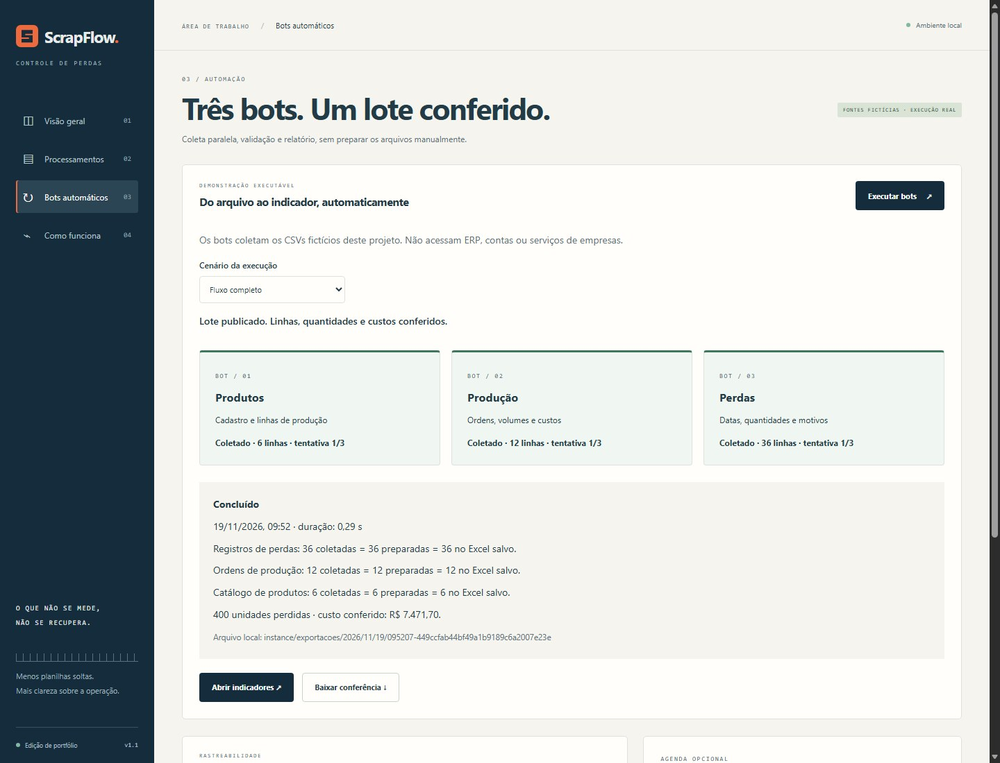
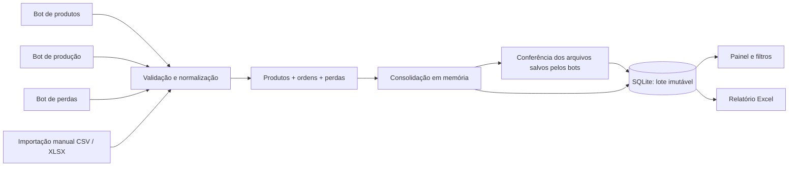

# ScrapFlow

**Controle de perdas de produção, da entrada dos arquivos ao relatório Excel.**

ScrapFlow é uma aplicação local em Python que coleta e consolida cadastro de produtos, ordens de produção e registros de perda. Valida as relações entre os arquivos, calcula indicadores e permite investigar os resultados em um painel. A edição 1.1 acrescenta **três bots em paralelo**, com tentativas limitadas, conferência dos arquivos salvos e histórico.

Desenvolvi esta edição para demonstrar um fluxo completo de automação e análise de dados, com regras explícitas e exemplos reproduzíveis. Os dados são fictícios; o projeto não representa uma empresa ou operação real.



## Leitura rápida do projeto

- **Foco:** automação em Python, validação de dados e indicadores de produção.
- **Evidência técnica:** [orquestração dos bots](scrapflow/automation.py), [pipeline de cálculo](scrapflow/pipeline.py), [contrato dos arquivos](docs/data-contract.md) e [testes da automação](tests/test_automation.py).
- **Para avaliar:** [execute os bots](#experimente-em-poucos-minutos), simule uma falha temporária, confira os indicadores e baixe os arquivos de conferência.
- **Estado:** aplicação local com dados fictícios; os [resultados do exemplo](#um-resultado-que-você-pode-conferir) permitem conferir os cálculos.

## Experimente em poucos minutos

Requisitos: **Python 3.11 ou superior**. Não é necessário instalar Microsoft Excel, Node.js ou um servidor de banco de dados para usar a aplicação.

```bash
git clone https://github.com/alex10presam-lang/scrapflow.git
cd scrapflow
python -m venv .venv
```

No Windows:

```powershell
.\.venv\Scripts\python.exe -m pip install -r requirements.txt
.\.venv\Scripts\python.exe app.py
```

No Linux ou macOS:

```bash
.venv/bin/python -m pip install -r requirements.txt
.venv/bin/python app.py
```

Abra **[localhost:5050](http://127.0.0.1:5050/#automation)**, selecione **Bots automáticos → Fluxo completo** e clique em **Executar bots**. Depois, use **Abrir indicadores** ou **Baixar conferência**. Nenhum serviço externo é necessário: os três coletores usam os CSVs fictícios incluídos no repositório.

A opção `python app.py --open` abre o navegador automaticamente. O painel inicial de indicadores continua sendo uma prévia: apenas abrir a página não cria uma execução. **Processar demonstração** também continua disponível para consolidar o exemplo diretamente, sem passar pelos bots.

Para testar a importação, use os três arquivos de [`examples/`](examples/) ou baixe o ZIP pela tela **Processamentos**.

## O problema que resolvi

Planilhas separadas podem contar histórias diferentes sobre a mesma produção. Um registro duplicado aumenta a perda; uma ordem sem cadastro impede calcular seu custo; um lote parcial pode levar a conclusões erradas.

O ScrapFlow trata o conjunto como uma unidade: valida as três fontes antes de salvar qualquer resultado. Um lote inválido retorna uma mensagem com a causa e não altera as execuções anteriores.

## O que está implementado

- Importação de CSV UTF-8 ou XLSX, com contrato de colunas e limite de tamanho.
- Validação de campos, identificadores únicos, relações entre tabelas, quantidades, datas e custos.
- Indicadores de perda, custo estimado, volume bom e ordens analisadas.
- Filtro por linha de produção, ranking de causas por custo e distribuição por data.
- Busca e paginação dos registros que compõem os indicadores.
- Histórico local em SQLite e exportação Excel com abas de resumo, perdas e causas.
- Interface responsiva, sem fontes, scripts ou serviços de terceiros.
- Três bots em segundo plano, com coleta paralela de produtos, produção e perdas.
- Até três tentativas por fonte, com esperas e acompanhamento de estado.
- Comparação de linhas e valores no XLSX das fontes e de linhas, quantidades e custo no relatório salvo.
- Publicação do lote e conclusão do trabalho na mesma transação SQLite.
- Arquivos por ano/mês/dia/execução, originais preservados por hash e download da conferência em ZIP.
- Histórico de trabalhos, incluindo falhas que não chegaram a publicar um lote.
- Template n8n opcional, com agendamento e deduplicação diária, sem ativação automática.

O sistema gera **um novo relatório**. Não altera arquivos de origem nem executa macros.

## Bots automáticos: três cenários para demonstrar

| Cenário | O que acontece |
| --- | --- |
| **Fluxo completo** | Três bots coletam os arquivos fictícios em paralelo; o sistema valida as relações, salva e relê os XLSX e publica o lote |
| **Falha temporária e nova tentativa** | A fonte de produção falha de forma simulada na primeira tentativa e se recupera na segunda, sem duplicar a publicação |
| **Lote inválido: bloquear publicação** | Uma perda aponta para uma ordem inexistente; a execução falha e preserva os lotes válidos anteriores |

Os cenários usam a mesma orquestração e o mesmo pipeline. **A execução é real e as fontes são fictícias.** Não há um ERP, um login corporativo ou um resultado pré-gravado substituindo o processamento.

O arquivo de conferência inclui `originais/`, `fontes.xlsx`, `relatorio.xlsx`, `conferencia.json`, `resumo.json` e `resumo.txt`. As três abas de `fontes.xlsx` são comparadas com os dados coletados. O relatório é relido para conferir registros de perda, unidades e custo em centavos antes de salvar o lote.

As execuções ficam em `instance/exportacoes/AAAA/MM/DD/HHMMSS-identificador/`, usando a data de Manaus. As datas fictícias das perdas não são alteradas. A passagem de mês ou ano cria os diretórios correspondentes, sem sobrescrever relatórios anteriores.

O botão **Baixar fluxo n8n** entrega um [template inativo](integrations/n8n-demo.workflow.json) para segunda a sexta às 09h de Manaus. É necessário ter n8n, importar/ativar o fluxo e manter o ScrapFlow em execução; o aplicativo não instala nem configura n8n sozinho. Solicitações agendadas repetidas reutilizam o trabalho do mesmo dia, inclusive depois de reiniciar a aplicação.

Veja [como apresentar, o que é validado e os limites da automação](docs/automation.md).

## Um resultado que você pode conferir

O lote incluído no repositório tem seis produtos, três linhas, 12 ordens e 36 ocorrências distribuídas em nove datas.

| Indicador | Resultado do exemplo |
| --- | ---: |
| Unidades boas | 12.378 |
| Unidades perdidas | 400 |
| Taxa de perda | 3,13% |
| Custo estimado | R$ 7.471,70 |

Esses valores são verificados nos testes. Não são resultados de uma empresa nem uma medição de ganho de produtividade.

```text
Taxa de perda = unidades perdidas / (unidades boas + unidades perdidas) × 100
Custo estimado = soma(quantidade perdida × custo unitário da ordem)
```

A taxa inclui todas as ordens do recorte, inclusive as que não têm perdas. Os custos são calculados com `Decimal` e armazenados em centavos inteiros. O indicador não inclui retrabalho, frete ou custo de oportunidade.

## Arquitetura



| Camada | Responsabilidade |
| --- | --- |
| `scrapflow/pipeline.py` | Leitura das tabelas, contratos, relações e cálculo dos indicadores |
| `scrapflow/storage.py` | Transações e consulta das execuções em SQLite |
| `scrapflow/automation.py` | Bots paralelos, tentativas, conferência e arquivo das execuções |
| `scrapflow/reports.py` | Geração do relatório e proteção de textos que poderiam virar fórmulas |
| `scrapflow/__init__.py` | Fábrica Flask, rotas HTTP e respostas de erro |
| `static/` e `templates/` | Interface sem framework e sem etapa de compilação |

Escolhi **Flask + SQLite** porque o uso é local e o volume é limitado. A importação manual é síncrona; os bots usam um trabalhador em segundo plano e três threads de coleta. Uma fila ou um banco externo não são necessários para esta demonstração local. Os cálculos não dependem das rotas HTTP, o que permite testá-los separadamente.

O [documento de arquitetura](docs/architecture.md) explica os limites dessas escolhas. O [contrato de dados](docs/data-contract.md) descreve os formatos aceitos e a [referência da API](docs/api.md) lista as rotas.

## Testes

Com o ambiente virtual ativo:

```bash
python -m unittest discover -s tests -v
```

São 47 testes de cálculo, leitura, validação, persistência, bots e API. Incluem custo exato em centavos, coleta realmente paralela, recuperação de falhas, concorrência, deduplicação após reinício, passagem de ano nos diretórios e bloqueio de arquivos salvos com linhas ou custos divergentes. A suíte não depende de Excel desktop nem usa dados externos.

O workflow do GitHub Actions configura a execução em Windows e Linux com Python 3.11, 3.12 e 3.13. A verificação de sintaxe dos dois arquivos JavaScript usa Node.js 22 apenas no CI.

Os três cenários dos bots também foram verificados no Edge, sem erros JavaScript, e a tela foi conferida em desktop e em 390 px sem rolagem horizontal. As capturas usam somente os exemplos fictícios: [desktop](docs/images/bots.jpg) e [celular](docs/images/bots-mobile.jpg).

## Organização

```text
scrapflow/
├── app.py                   # Entrada do servidor local
├── scrapflow/                  # Backend e regras de negócio
├── templates/index.html     # Estrutura da interface
├── static/                  # Estilos, comportamento e marca
├── examples/                # Três arquivos CSV fictícios
├── integrations/            # Template n8n opcional e inativo
├── tests/                   # Testes automatizados
├── docs/                    # Contratos, arquitetura e capturas
├── .github/workflows/       # Integração contínua
└── requirements.txt
```

O banco é criado em `instance/scrapflow.sqlite3`, fora do versionamento. Os uploads manuais são processados em memória. Os bots também preservam suas cópias e relatórios em `instance/exportacoes/`, ignorado pelo Git. O histórico de lotes mostra as últimas 100 publicações e o histórico dos bots mostra os últimos 30 trabalhos. Não há limpeza automática dos arquivos.

## Limites da versão

- Aplicação local, sem autenticação. O servidor escuta somente em `127.0.0.1`; não é uma implantação de produção na internet.
- Upload manual de até 5 MB e 10.000 registros por arquivo. O processamento manual é síncrono; os bots são assíncronos.
- Quantidades inteiras e valores em BRL. Não há conversão cambial, unidades fracionárias ou integração com ERP.
- CSV/XLSX devem seguir o contrato genérico. Não há compatibilidade com um modelo empresarial específico, arquivos `.xlsm` ou macros.
- O gráfico temporal apresenta as últimas 14 datas com ocorrências; a tabela e a exportação mantêm o lote completo.
- Busca afeta a tabela. O filtro de linha afeta os indicadores. A exportação sempre contém o lote completo.

Próximas melhorias possíveis: retenção configurável, comparação entre lotes publicados e testes de navegador no CI. Elas ainda não estão implementadas. Os bots desta edição não navegam em ERP e não possuem conectores para fontes reais; isso está separado da demonstração pública.

## Autor

[Alexandre José Prestes de Alencar](https://github.com/alex10presam-lang) · análise de dados e automações em Python.
