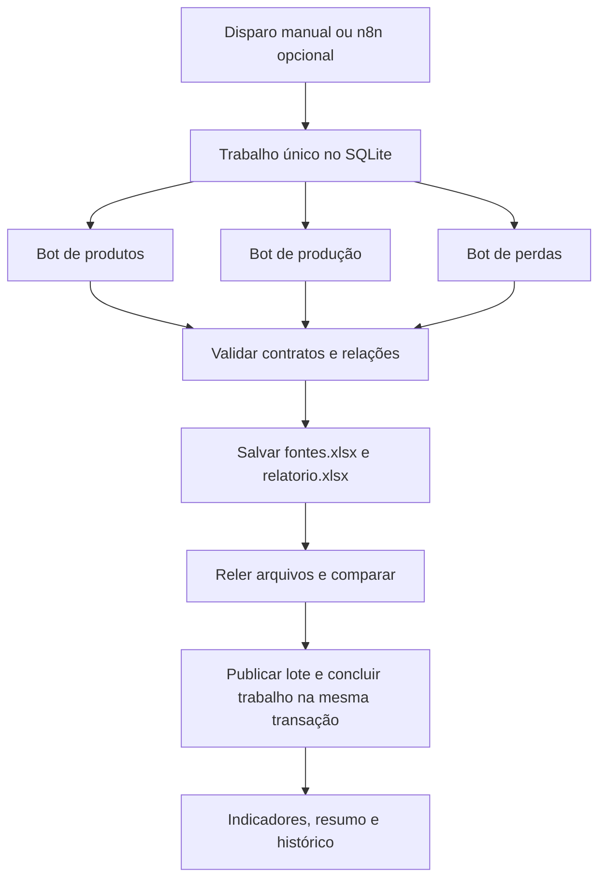

# Bots automáticos de demonstração

Os bots executam um fluxo real de coleta, gravação, validação e publicação usando exclusivamente os três CSVs fictícios de `examples/`. Não há login corporativo, acesso a ERP, WebAgent, Excel desktop ou leitura de diretórios pessoais.

## Como apresentar

1. Instale `requirements.txt` e execute `python app.py --open`. A opção `--open` abre o navegador; também é possível acessar `http://127.0.0.1:5050/#automation` manualmente.
2. Na tela **Bots automáticos**, selecione **Fluxo completo** e clique em **Executar bots**.
3. Acompanhe as três fontes, a tentativa e a conferência final.
4. Use **Abrir indicadores** para consultar o lote publicado ou **Baixar conferência** para inspecionar os arquivos.
5. Execute **Falha temporária e nova tentativa**. A fonte de produção falha de forma controlada na primeira tentativa, aguarda dois segundos e tenta novamente. O resultado do exemplo continua sendo 400 unidades perdidas e R$ 7.471,70.
6. Execute **Lote inválido: bloquear publicação**. O coletor de perdas recebe um exemplo com uma ordem inexistente. A coleta fica disponível para inspeção, mas o lote não é publicado nem substitui o último resultado válido.

As fontes são arquivos locais pequenos; o cenário normal pode terminar rapidamente. As fases exibidas correspondem ao trabalho executado, sem uma barra de progresso artificial. Os cenários de falha são explicitamente simulados; não representam incidentes de uma organização.

## Fluxo



Cada bot lê no máximo 5 MB, preserva uma cópia CSV e compara seu hash SHA-256. Os três coletores rodam em um `ThreadPoolExecutor` com três trabalhadores. Depois que todos terminam, o pipeline existente valida identificadores, relações, datas e valores.

### Tentativas

- Até três tentativas por fonte para erros de leitura/indisponibilidade.
- Esperas de dois e quatro segundos antes das tentativas adicionais.
- Erros de conteúdo ou de validação não são repetidos.
- Ao falhar uma fonte, as esperas das outras são canceladas e o lote não é publicado.
- A gravação do resultado não é repetida como se fosse uma nova coleta.

O cenário de falha temporária usa essa mesma política; não possui um resultado pré-gravado que substitua a execução.

## Conferência dos arquivos salvos

O arquivo `fontes.xlsx` contém abas `produtos`, `producao` e `perdas`. O sistema relê o arquivo salvo e compara cabeçalho, contagem e todos os valores com as tabelas coletadas. Textos são gravados explicitamente como texto para preservar códigos e evitar execução de fórmulas.

O arquivo `relatorio.xlsx` mantém as abas `Resumo`, `Perdas` e `Causas`. A conferência relê as linhas de perdas, sua quantidade total e o custo total em centavos; também verifica o custo apresentado no resumo. Uma divergência impede a publicação no SQLite.

Não se trata de comprovar regras financeiras externas: são os contratos e os cálculos genéricos documentados neste repositório.

## Arquivos por data

```text
instance/exportacoes/AAAA/MM/DD/HHMMSS-identificador/
  originais/produtos.csv
  originais/producao.csv
  originais/perdas.csv
  fontes.xlsx
  relatorio.xlsx
  conferencia.json
  resumo.json
  resumo.txt
```

O diretório usa a data de execução no fuso de Manaus, não as datas fictícias dos registros. A passagem de mês ou ano cria os diretórios correspondentes; cada trabalho mantém seu próprio relatório. Não há sobrescrita de uma planilha empresarial mensal ou suporte a `.xlsm`.

Execuções que falham podem conter apenas parte desses arquivos. O estado persistido na API é a referência do resultado; uma publicação bem-sucedida continua válida se houver uma falha posterior ao gravar o resumo de texto, registrada como aviso. Não há expurgo automático dos arquivos.

## Histórico e concorrência

A tabela `automation_jobs` guarda o estado de cada trabalho e suas três fontes. Uma restrição SQLite permite apenas um trabalho ativo por banco, inclusive quando chegam solicitações concorrentes. Os indicadores continuam acessíveis enquanto a coleta acontece.

A publicação insere o lote imutável e marca o trabalho como concluído na mesma transação. Repetir a conclusão do mesmo trabalho não insere outro lote. A aplicação exibe as últimas 30 execuções dos bots; o histórico de lotes existente continua mostrando até 100 publicações.

No início da aplicação, trabalhos cujo processo não existe mais são marcados como interrompidos. Outro processo ainda vivo não é interrompido automaticamente. A edição continua destinada a um único servidor local, não a uma instalação distribuída com vários workers.

## Agendamento n8n opcional

O arquivo [`integrations/n8n-demo.workflow.json`](../integrations/n8n-demo.workflow.json) está inativo no repositório. Ele pode ser baixado pela interface e importado no n8n. O JSON utiliza nós de HTTP, espera e agendamento; não contém credenciais nem instala um servidor n8n.

Depois de importar, com o ScrapFlow em execução, teste pelo disparo manual do workflow. Para usar a agenda, ative/publique o fluxo no seu n8n. O exemplo agenda segunda a sexta às 09h no fuso `America/Manaus`, consulta o andamento e só termina com sucesso se o lote estiver publicado. Falhas e interrupções encerram o fluxo com erro. Há um limite de execução de cinco minutos no template.

O corpo do POST é:

```json
{"trigger": "schedule", "scenario": "normal"}
```

O servidor usa a data de Manaus como chave do disparo agendado. Solicitações repetidas no mesmo dia reutilizam o trabalho, mesmo depois de concluído ou se a aplicação reiniciar. Um novo teste independente deve usar `trigger: manual` pela interface. Um disparo agendado que falhar continua registrado; o operador pode iniciar outra execução manual após revisar o erro.

O template pressupõe n8n e ScrapFlow acessíveis pelo mesmo host. Se o n8n estiver em um contêiner ou outra máquina, ajuste as URLs de acordo com a rede local; `127.0.0.1` dentro de um contêiner não aponta para o computador anfitrião. Não exponha a API sem autenticação na internet. Nenhum workflow é importado ou ativado automaticamente por executar o ScrapFlow.

## Limites

Os bots demonstram coleta e processamento de arquivos locais fictícios, não navegação em um ERP ou automação de cliques no Excel. Não incluem conectores para fontes reais, gerenciamento de segredos, instalação de tarefas do Windows ou sincronização com OneDrive. Esses recursos exigiriam outra configuração e avaliação de segurança.

O processamento manual permanece síncrono; apenas o trabalho dos bots usa execução em segundo plano. A persistência SQLite é transacional, mas o diretório de exportações não é uma transação de sistema de arquivos: uma interrupção pode deixar arquivos incompletos para inspeção. A aplicação não executa macros e não altera os arquivos de exemplo.
